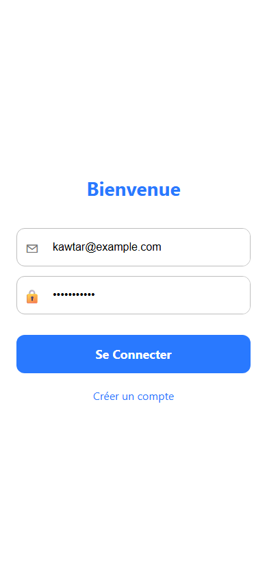
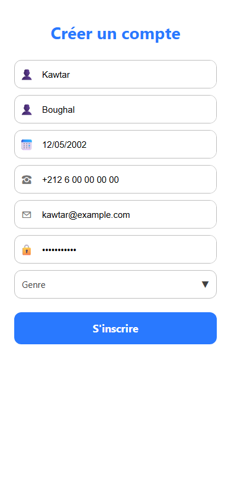
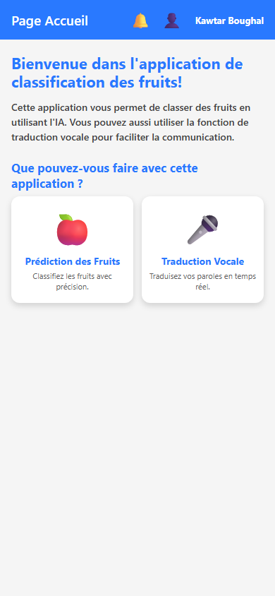
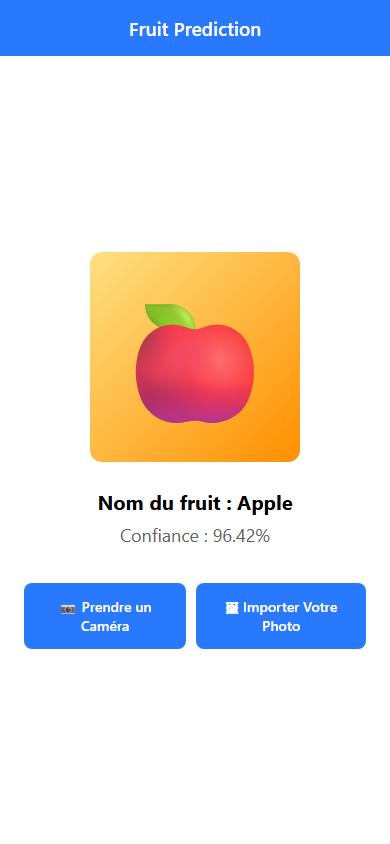
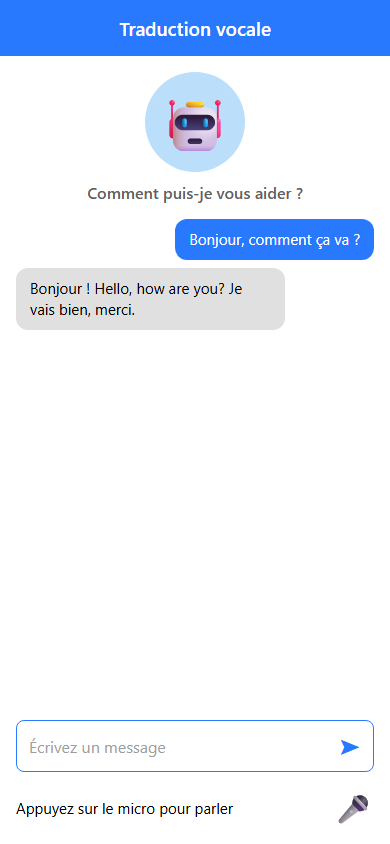

# Rapport final — Prédiction des fruits (application mobile Flutter + IA embarquée)

## 1. Résumé exécutif

Ce projet présente le développement d'une **application mobile cross-platform** en
**Flutter/Dart** capable d'**identifier un fruit à partir d'une photographie** grâce à
un modèle d'**intelligence artificielle embarqué (TensorFlow Lite)** exécuté
**localement sur l'appareil**, sans nécessiter de connexion internet pour la
classification.

L'application couvre l'ensemble du parcours utilisateur : **authentification sécurisée**
(Firebase Auth), **capture ou import d'image** (caméra / galerie), **inférence
on-device** renvoyant le fruit reconnu et un **score de confiance**, ainsi qu'un
**assistant vocal** combinant reconnaissance vocale et modèle génératif Google Gemini.

L'accent est mis sur la **brique déploiement d'un modèle d'IA** (passage du modèle
entraîné à une application mobile temps réel), la qualité de l'interface **Material 3**
et les **bonnes pratiques de sécurité** (externalisation des clés API).

## 2. Contexte, objectif et problématique

La classification automatique d'images est un domaine phare de l'IA. Reconnaître un
fruit depuis une photo est trivial pour l'œil humain mais constitue un cas d'école
intéressant pour un système automatique : variabilité de l'apparence (couleur, forme,
angle, luminosité), nombre de classes à distinguer, et contrainte d'usage sur mobile.

Les approches 100 % cloud présentent des inconvénients : dépendance réseau, latence,
coût d'inférence serveur et envoi des images de l'utilisateur à un tiers.

**Objectif :** concevoir une application mobile qui identifie un fruit en temps réel,
**hors-ligne**, avec une interface simple et une authentification, tout en intégrant une
fonction d'assistant vocal.

**Problématique :** comment déployer un modèle de classification d'images dans une
application mobile afin d'obtenir une prédiction **rapide, locale et privée**, et
comment structurer l'application (authentification, capture, inférence, restitution) ?

## 3. Fonctionnalités (solution développée)

### 3.1 Authentification (Firebase Auth)
- Inscription avec profil complet (nom, prénom, date de naissance, téléphone, email, genre).
- Enregistrement du nom d'affichage sur le compte Firebase.
- Connexion email / mot de passe, session persistante, déconnexion.

### 3.2 Prédiction de fruits (IA embarquée)
- Sélection d'une image via la **caméra** ou la **galerie** (`image_picker`).
- Classification par le modèle **TensorFlow Lite** (`model.tflite`) parmi **10 classes** :
  Apple, Avocado, Banana, Cherry, Kiwi, Mango, Orange, Pineapple, Strawberries, Watermelon.
- Affichage du **fruit reconnu** et du **score de confiance (%)**.
- Exécution **entièrement locale** : aucune image n'est transmise pour la classification.

### 3.3 Assistant vocal (Google Gemini)
- Reconnaissance vocale via `speech_to_text`.
- Dialogue / traduction assistée par le modèle **Gemini** (`google_generative_ai`).
- Saisie texte possible en complément.

### 3.4 Interface & navigation
- Thème **Material 3** cohérent (couleur d'accent bleue).
- Écrans dédiés + menu latéral (drawer) sur la page d'accueil.

## 4. Architecture technique

Application **Flutter** structurée en **écrans** naviguant par **routes nommées** dans
`MaterialApp`. Le modèle et ses libellés sont embarqués comme **assets**.

```text
lib/
├── main.dart                       # init Firebase, thème, routes nommées
├── firebase_options.dart           # config Firebase (web / android / ios)
└── screens/
    ├── login_screen.dart           # connexion
    ├── register_screen.dart        # inscription + profil
    ├── home_page.dart              # accueil + drawer
    ├── fruit_pred_page.dart        # inférence TFLite
    └── voice_translation_page.dart # assistant vocal Gemini

assets/model/
├── model.tflite                    # modèle de classification (10 classes)
└── labels.txt                      # libellés des classes
```

**Flux de prédiction (edge AI) :**

```text
Caméra / Galerie ──► ImagePicker ──► Prétraitement image
                                              │
                                Tflite.runModelOnImage (local)
                                              │
                                    Top-1 : fruit + confiance
```

## 5. Technologies

| Technologie | Rôle |
|---|---|
| **Flutter / Dart** | Framework mobile cross-platform et langage |
| **TensorFlow Lite** (`flutter_tflite`) | Modèle d'IA embarqué, inférence on-device |
| **Firebase Auth** (`firebase_core`, `firebase_auth`) | Authentification et comptes |
| **Google Gemini** (`google_generative_ai`) | Assistant conversationnel / traduction |
| **Speech-to-Text** (`speech_to_text`) | Reconnaissance vocale |
| **Image Picker** (`image_picker`) | Accès caméra / galerie |

## 6. Interfaces (captures d'écran)

### 6.1 Écran de connexion
Authentification email / mot de passe via Firebase. Redirection vers l'inscription.



*Écran de connexion.*

### 6.2 Écran d'inscription
Création de compte avec profil complet ; le nom d'affichage est enregistré sur Firebase.



*Écran d'inscription.*

### 6.3 Page d'accueil
Présentation des fonctionnalités et accès aux deux modules (prédiction de fruits,
traduction vocale) via des cartes et un menu latéral.



*Page d'accueil.*

### 6.4 Prédiction de fruits
Sélection d'une image (caméra ou galerie) puis inférence locale : le fruit reconnu et
le score de confiance sont affichés.



*Résultat de prédiction d'un fruit.*

### 6.5 Traduction vocale / assistant
Dialogue vocal ou texte avec l'assistant Gemini ; bulles de conversation utilisateur / bot.



*Assistant vocal.*

## 7. Implémentation et corrections apportées

Lors de la reprise du projet, plusieurs points ont été corrigés pour garantir le bon
fonctionnement et la sécurité :

1. **Appel Gemini réécrit avec le SDK officiel.** L'appel HTTP brut initial utilisait un
   format de requête invalide pour l'API Generative Language et une réponse parsée
   (`data['response']`) inexistante. Il est remplacé par le SDK `google_generative_ai`
   (`GenerativeModel` + `ChatSession`), déjà déclaré dans `pubspec.yaml`.
2. **Clé API externalisée.** La clé Gemini codée en dur a été retirée du code source ;
   elle est désormais injectée au lancement via `--dart-define=GEMINI_API_KEY=...`.
3. **Profil complété.** À l'inscription, le nom complet est enregistré sur le profil
   Firebase (`updateDisplayName`) au lieu d'être ignoré.
4. **Parcours web clarifié.** Sur le web, l'écran de prédiction n'exécute pas
   l'inférence `flutter_tflite` ; un message explicite remplace l'état « Analyse en
   cours… » qui restait bloqué.
5. **Dépendance nettoyée.** Le paquet `http`, devenu inutile après l'usage du SDK Gemini,
   a été retiré de `pubspec.yaml`.

## 8. Lien Data Science / IA

Ce projet illustre la **phase de déploiement (MLOps / edge AI)** d'un pipeline de Data
Science appliqué à la vision par ordinateur :

- **Entraînement** (hors de ce dépôt) : un modèle de classification d'images est appris,
  typiquement par **Transfer Learning** sur un CNN léger (ex. MobileNet) à partir d'un
  jeu d'images de fruits.
- **Conversion** : le modèle entraîné est exporté au format **TensorFlow Lite** (`.tflite`).
- **Inférence embarquée** : le modèle tourne **sur l'appareil**, en temps réel, sans serveur.
- **Restitution** : le résultat (classe + confiance) est présenté dans l'UI mobile.

Cette chaîne « notebook → modèle → application » ainsi que la maîtrise des contraintes
**latence / taille / confidentialité** de l'IA en périphérie constituent les compétences
transverses valorisées ici.

## 9. Limites et perspectives

- **Entraînement du modèle non versionné** dans ce dépôt : le `.tflite` est fourni prêt à
  l'emploi. Ajouter le notebook/script d'entraînement rendrait la chaîne entièrement
  reproductible.
- **Inférence mobile uniquement** : `flutter_tflite` cible Android/iOS ; le web affiche un
  message dédié.
- **Clé API côté client** : externalisée, mais un **proxy backend** éviterait toute
  exposition de la clé Gemini côté application.
- **Robustesse du modèle** : le score de confiance et un éventuel **top-3** amélioreraient
  l'interprétation des cas ambigus.
- **Perspectives** : davantage de classes, historique local des analyses, quantification
  du modèle pour réduire sa taille, tests d'interface automatisés.

## 10. Conclusion

Le projet démontre la capacité à **concevoir et livrer une application mobile complète**
intégrant de l'**IA embarquée** : authentification, capture d'image, inférence TensorFlow
Lite on-device et assistant vocal Gemini, le tout dans une interface Material 3 soignée.
Il constitue un cas concret de **mise en production d'un modèle de vision** dans un
contexte mobile, avec une attention particulière portée à la sécurité des clés et à
l'expérience utilisateur.

## English summary

This project is a cross-platform **Flutter** mobile app that recognizes a fruit from a
photo using an **on-device TensorFlow Lite** model (offline inference). It includes
**Firebase Auth**, image capture (camera/gallery), a confidence-scored prediction, and a
**voice assistant** built on speech-to-text and **Google Gemini**. The report covers the
context, features, architecture, screenshots, and the corrections applied (SDK-based
Gemini call, externalized API key, profile saving, web handling). It positions the work as
the **edge-AI / deployment stage** of a computer-vision pipeline. Run with
`flutter pub get` then `flutter run`, providing the Gemini key via
`--dart-define=GEMINI_API_KEY=...`.

